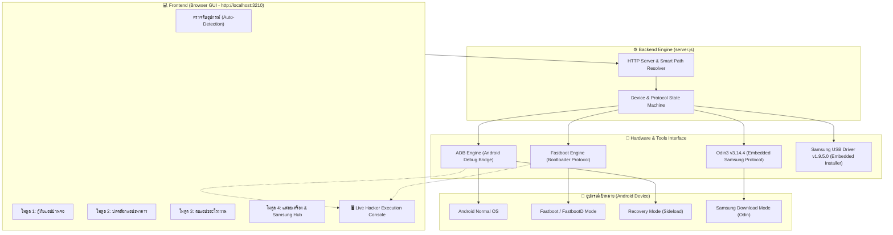
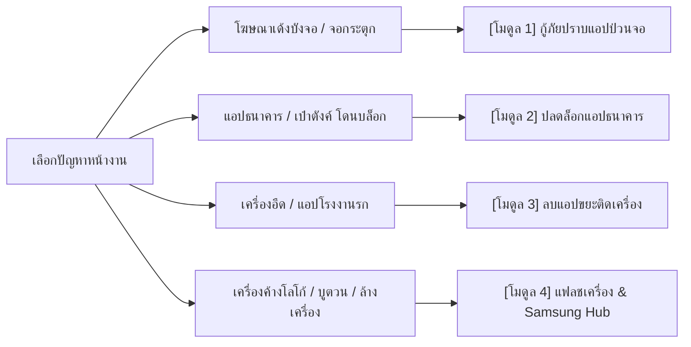

# 🛡️ Android Rescue Shield: คู่มือขั้นตอนการทำงานและวิธีใช้งานฉบับสมบูรณ์

> **โปรแกรมกู้ภัยมือถือระดับฮาร์ดแวร์ • ล้างแอปป่วนจอ • ปลดล็อกแอปธนาคาร • แฟลชเครื่อง & กู้บริค (Zero-Setup & 100% Offline)**

---

## 🏛️ 1. สถาปัตยกรรมและขั้นตอนการทำงานของระบบ (System Workflow)

Android Rescue Shield ถูกออกแบบตามหลัก **Zero-Dependency & Offline First** ทำงานเป็นแอปพลิเคชัน Desktop Hybrid ผ่าน Localhost โดยไม่ต้องต่ออินเทอร์เน็ตหน้างาน และไม่ต้องติดตั้ง `npm install` เพิ่มเติม

---

## 🚀 2. ขั้นตอนการเริ่มต้นใช้งาน (Quick Start)

### ขั้นตอนที่ 1: การเตรียมโทรศัพท์มือถือ (ทำครั้งเดียว)
1. เข้า **การตั้งค่า (Settings)** > **เกี่ยวกับโทรศัพท์ (About phone)**
2. แตะที่ **"หมายเลขบิลด์ (Build Number)" 7 ครั้ง** จนขึ้นข้อความว่า *คุณเป็นนักพัฒนาแล้ว*
3. เข้า **ตัวเลือกสำหรับนักพัฒนา (Developer Options)** > เปิดใช้งาน **"การดีบัก USB" (USB Debugging)**
4. เสียบสาย USB เข้ากับคอมพิวเตอร์ หากมีหน้าต่างเด้งขึ้นมาบนมือถือ ให้ติ๊ก **"อนุญาตเสมอจากคอมพิวเตอร์นี้" (Always allow)** แล้วกด ตกลง

### ขั้นตอนที่ 2: เปิดโปรแกรม Android Rescue Shield
1. ดับเบิ้ลคลิกที่ไฟล์ **`start.bat`** ในโฟลเดอร์โปรเจกต์
2. ตัวโปรแกรมจะเคลียร์พอร์ตและเปิดหน้าต่าง GUI อัตโนมัติที่ `http://localhost:3210`
3. แถบสถานะด้านบนจะแสดงสถานะการเชื่อมต่อทันที (🟢 เชื่อมต่อแล้ว / ⚡ โหมด Fastboot / 🟡 รอการอนุญาต)

---

## 📋 3. คู่มือการใช้งาน 4 โมดูลหลัก (Step-by-Step)

---

### 🚨 โมดูล 1: กู้ภัยปราบแอปป่วนจอ (Rescue Shield)
> **เหมาะสำหรับ:** เครื่องที่ติดไวรัส, Adware เด้งโฆษณารัวๆ ทับหน้าจอจนกดอะไรไม่ได้, หรือแอปรีโมทขโมยแตะหน้าจอเอง

1. **⚡ ปุ่ม Instant Emergency Kill (แถบแดงด้านบน):**
   - เมื่อเสียบสาย USB แล้วจอมือถือยังมีโฆษณาเด้งบัง ให้กดปุ่มนี้ทันที
   - ระบบจะตรวจจับแอปที่กำลังบังหน้าจออยู่ (ผ่าน Multi-layered Search 4 ชั้น) แล้วสั่ง Force-Stop ให้หน้าจอดับลงทันที
2. **👻 ปุ่ม Ghost Touch Killer:**
   - ใช้เมื่อมีอาการ "จอเลื่อนเอง" หรือแอปกำลังแย่งทัชสกรีน
   - ปุ่มนี้จะสั่ง **ปิดสิทธิ์ Accessibility (การเข้าถึง) ทั้งหมดในเครื่องทันที** ทำให้มัลแวร์เป็นอัมพาต
3. **🔍 Deep Risk Inspector (ตารางวิเคราะห์สิทธิ์อันตราย):**
   - รายชื่อแอปในเครื่องจะถูกสแกนสิทธิ์ระดับลึก เช่น:
     - 🔴 `SYSTEM_ALERT_WINDOW`: สิทธิ์วาดทับหน้าจอ (ตัวการโฆษณาบังจอ)
     - 🔴 `RECEIVE_BOOT_COMPLETED`: สิทธิ์เริ่มทำงานทันทีตอนเปิดเครื่อง
     - 🔴 `NO_LAUNCHER_ICON`: ซ่อนไอคอนในหน้าหลัก พรางตัวไม่ให้เจ้าของเห็น
4. **🗑️ Force Uninstall & ปลด Device Admin อัตโนมัติ:**
   - กดปุ่ม "ถอนการติดตั้ง" ที่แอปต้องสงสัย
   - ระบบจะตรวจเช็คและ **สั่งปลดสิทธิ์ Device Admin ออกก่อนอัตโนมัติ** แล้วสั่งลบแอปทิ้งทันที แม้ปุ่มลบในโทรศัพท์จะกดไม่ได้ก็ตาม

---

### 🏦 โมดูล 2: ปลดล็อกแอปธนาคาร & เป๋าตังค์ (Bank Safety Guard)
> **เหมาะสำหรับ:** เครื่องที่เข้าแอป K PLUS, SCB EASY, Krungthai NEXT, เป๋าตัง หรือแอปทางรัฐ ไม่ได้ โดยขึ้นเตือนว่า "ระบบตรวจพบการเปิดโหมดนักพัฒนา" หรือ "มีแอปกำลังใช้งานกล้อง/การเข้าถึง"

1. **📷 Background Camera Inspector:**
   - ตรวจจับแบบ Real-time ว่ามีแอปใดแอบเปิดเซ็นเซอร์กล้องค้างไว้เบื้องหลังหรือไม่ (สาเหตุที่ทำให้สแกนหน้า KYC ไม่ผ่าน)
   - หากพบ สามารถกดปุ่มสั่งปิดแอปที่แอบใช้กล้องได้ทันที
2. **👁️ ตรวจสอบสิทธิ์ Accessibility สุ่มเสี่ยง:**
   - แสดงรายชื่อบริการที่เปิดสิทธิ์ดูหน้าจอ พร้อมปุ่มกดสั่งปิดบริการที่ไม่ได้ใช้งาน
3. **🔒 1-Click ปิดโหมดนักพัฒนา & USB Debugging:**
   - กดปุ่ม **"ปิดโหมดการดีบัก USB ทันที"**
   - คอมพิวเตอร์จะส่งคำสั่งระดับฮาร์ดแวร์ไปสั่งปิด Developer Options ในโทรศัพท์ทันที
   - หน้าจอจะแจ้งเตือนว่าปลอดภัยแล้ว จากนั้นสามารถดึงสาย USB ออกแล้วเปิดเข้าแอปธนาคารได้ทันที 100%

---

### 🧹 โมดูล 3: ลบแอปขยะติดเครื่องจากโรงงาน (Universal Debloater)
> **เหมาะสำหรับ:** เครื่องหน่วยความจำเต็ม เครื่องอืด ช้า หรือมีแอปติดเครื่องที่ผู้ผลิตยัดเยียดมาแล้วลบไม่ออก

1. **สแกนและจัดหมวดหมู่ความปลอดภัยอัตโนมัติ:**
   - 🟢 **Safe to Remove:** แอปขยะที่ลบได้ปลอดภัย 100% (เช่น Facebook App Manager, Mi Cleaner, Samsung Bixby, Booking.com, แอปเกมติดเครื่อง)
   - 🟡 **Recommended:** แอปเสริมที่ไม่ส่งผลกระทบต่อการโทรเข้า-ออก (เช่น เว็บบราวเซอร์ค่ายมือถือ, YouTube Music)
   - 🔴 **System Core:** ระบบป้องกันการเผลอลบแอปสำคัญ
2. **ลบแอปโดยไม่ต้องรูทเครื่อง (Zero-Root):**
   - ทำงานผ่านคำสั่ง `pm uninstall -k --user 0` ลบแอปออกจากระบบของผู้ใช้ทันที หน่วยความจำคืนกลับมา เครื่องลื่นขึ้นชัดเจน
3. **🔄 One-Click Restore (กู้คืนได้ตลอดเวลา):**
   - หากเปลี่ยนใจหรือต้องการใช้แอปเดิม สามารถกดปุ่ม **"กู้คืนแอป"** ได้ตลอดเวลา ระบบจะดึงไฟล์แพ็กเกจเดิมกลับมาใช้งานได้ทันทีโดยไม่ต้องดาวน์โหลดใหม่

---

### ⚡ โมดูล 4: แฟลชเครื่อง & กู้บริค (Multi-Brand Hardware & Unbrick Hub)
> **เหมาะสำหรับ:** เครื่องค้างโลโก้, บูตวน (Bootloop), แฟลชรอมศูนย์, ล้างเครื่องขายต่อ (Clean Wipe), หรือลง Magisk / Recovery

#### 🧭 Multi-Brand Technician Navigation
หน้าต่าง Flasher มีแถบเมนูด้านบนให้ช่างสลับโหมดการทำงานตามแบรนด์ได้ใน 1 คลิก:

#### 🔵 ส่วนที่ 1: ศูนย์อำนวยความสะดวกช่าง Samsung & Odin Hub
* **100% Offline Embedded:** ฝังทั้งโปรแกรม **Odin3 v3.14.4** และตัวติดตั้ง **Samsung USB Driver v1.9.5.0** อยู่ในโฟลเดอร์ `tools/samsung/` ของโปรแกรม ไม่ต้องดาวน์โหลดแยก
* **ระบบเช็ค Driver & Odin อัตโนมัติ:** มี Badge บอกสถานะชัดเจนว่าเครื่องคอมพิวเตอร์ลงไดรเวอร์หรือยัง พร้อมปุ่มติดตั้งแบบ UAC ใน 1 คลิก
* **ตรวจเช็คฮาร์ดแวร์ & ลิงก์รอมตรงรุ่น:** สแกนชื่อรุ่น (Model), รหัส CSC (เช่น THL), และเลข **Binary Bit (SW REV)** ให้อัตโนมัติ ป้องกันช่างมือใหม่โหลดรอมผิดบิต
* **⚡ Smart Odin Auto-Slotter & Wipe Selector (ระบบจัดช่องไฟล์อัตโนมัติ):**
  * เพียงแตกไฟล์รอมใน Downloads แล้วกดปุ่ม "ตรวจหารอมในเครื่องอัตโนมัติ"
  * ระบบจะดึงไฟล์ `BL_...`, `AP_...`, `CP_...` ไปจัดลงช่องให้อัตโนมัติทันที
  * **สลับโหมด Clean Wipe vs Keep Data ได้ใน 1 คลิก:**
    * ⚡ **Clean Wipe:** ดึงไฟล์ `CSC_xxxx.tar.md5` ลงช่อง CSC อัตโนมัติ (ล้างเครื่องเกลี้ยงเหมือนใหม่)
    * ⭐ **Keep Data:** สลับไปดึงไฟล์ `HOME_CSC_xxxx.tar.md5` ลงช่อง CSC ทันที (กู้ระบบรูปและข้อมูลลูกค้าไม่หาย)
  * มีปุ่ม `📋 คัดลอก Path` แยกรายช่อง และปุ่มคัดลอกพร้อมกันทั้ง 4 ช่อง นำไปวางใน Odin3 ได้ใน 2 วินาที

#### 🟠 ส่วนที่ 2: ศูนย์อำนวยความสะดวก Xiaomi, Redmi & POCO (Native Fastboot Flasher)
* **100% Native Fastboot (ไม่ต้องติดตั้ง Mi Flash Tool เพิ่ม):** โปรแกรมใช้คำสั่ง Fastboot ของ AOSP ที่มีในตัว สั่งรันสคริปต์แฟลชตรงเข้าชิปมือถือได้ทันที
* **ตรวจจับรุ่น & สถานะ Bootloader:** ดึง Codename เครื่อง (เช่น `curtana`, `sweet`, `vayu`) และเช็คว่า Bootloader ปลดล็อกแล้วหรือไม่ พร้อมลิงก์ดาวน์โหลดรอมศูนย์แท้ตรงรุ่น (XiaomiROM / MiFirm)
* **สแกนหารอม Fastboot อัตโนมัติ:** ตรวจหาโฟลเดอร์รอมที่แตกไฟล์ `.tgz` ไว้แล้ว พร้อมนับจำนวนไฟล์อิมเมจในโฟลเดอร์ `images/`
* **3 โหมดการแฟลชในคลิกเดียว:**
  * ⚡ **Clean Wipe (`flash_all.bat`)**: ล้างเครื่องเกลี้ยงโรงงาน เหมือนแกะกล่องใหม่
  * ⭐ **Keep Data (`flash_all_except_storage.bat`)**: กู้เครื่องวนลูป/ค้างโลโก้ รูปถ่ายและข้อมูลไม่หาย
  * 🔒 **Clean & Lock (`flash_all_lock.bat`)**: ล้างเครื่องพร้อมล็อก Bootloader คืนค่าศูนย์
* **🚀 1-Click Flash Execution:** กดปุ่มเริ่มแฟลชได้ทันทีจากหน้าเว็บ พร้อมสตรีม Log แสดงความคืบหน้าลง Terminal แบบเรียลไทม์

#### 🟢 ส่วนที่ 3: ศูนย์อำนวยความสะดวก Oppo, Realme & Vivo (Recovery & Emergency)
* **กู้เครื่องรูปไม่หาย (Recovery OTA):** รวมลิงก์ดาวน์โหลดรอมศูนย์ทางการ (Official Recovery OTA) สำหรับนำไฟล์ `.zip` หรือ `.ozip` มาแฟลชผ่านช่อง **ADB Sideload** ในโปรแกรม หรือใส่ Flash Drive ต่อสาย OTG
* **โหมดกู้ชีพฉุกเฉิน (เครื่องดับสนิท / จอดำ):**
  * ปุ่ม 1-คลิก สั่งมือถือเข้าโหมด **EDL (Qualcomm Emergency 9008)**
  * แนะนำแนวทางการใช้โปรแกรมเฉพาะทางระดับชิปเซ็ต (MsmDownloadTool, AFTool, SP Flash Tool สำหรับชิป MTK)

#### ⚡ ส่วนที่ 4: Fastboot Universal Partition Flasher & Sideload
* **Partition Flasher:** เลือกระบุไฟล์ `.img` แล้วเลือกพาร์ติชัน (`boot`, `init_boot`, `recovery`, `vbmeta`, `super` ฯลฯ) มี Smart Path Resolver ช่วยค้นหาไฟล์ใน Downloads ให้อัตโนมัติ
* **🚀 Temporary Boot:** ทดลองบูตอิมเมจชั่วคราว (`fastboot boot <image>`) โดยไม่เขียนทับ ROM จริง
* **🛟 A/B Slot Switcher:** ปุ่มสลับ Slot A <-> B ใน 1 คลิก แก้อาการเครื่องบูตวนหลังอัปเดตระบบผิดพลาด
* **⚡ ล้างเครื่องโรงงาน (Fastboot Factory Reset):** ปุ่มล้างแคช (Wipe Cache) และปุ่มล้างข้อมูลทั้งหมด (Wipe Userdata)
* **📥 Recovery Sideload:** ติดตั้งไฟล์อัปเดตหรือรอมผ่าน `adb sideload update.zip` ใน Recovery Mode

---

## 💡 4. สูตรลัดช่างหน้างาน (Technician Field Cheat Sheet)

| ปัญหาหน้างาน | เคล็ดลับวิธีแก้ด่วนก่อนต่อคอมพิวเตอร์ |
| :--- | :--- |
| **จอมือถือเด้งโฆษณารัวจนทัชไม่ได้** | **สูตรตัดเน็ตทันที:** ใช้เข็มจิ้มถาดซิมการ์ดออกทันที และปิดเราเตอร์ WiFi โฆษณา 90% จะโหลดไม่ขึ้นและจอจะหยุดเด้ง |
| **ทัชสกรีนหลอก แตะเองจนเปิดดีบักไม่ได้** | **สูตร Safe Mode:** กดปุ่ม Power ค้าง > แตะปุ่ม "ปิดเครื่อง" บนหน้าจอค้างไว้ 2 วินาที ระบบจะบูตเข้า Safe Mode แช่แข็งแอปภายนอก 100% ทำให้เปิด USB Debugging ได้ง่ายดาย |
| **หน้าจอแตกหรือทัชไม่ติดเลย** | **สูตรเมาส์ OTG:** เสียบเมาส์คอมพิวเตอร์ผ่านหัวแปลง OTG เข้าตูดมือถือ จะมีเคอร์เซอร์เมาส์ขึ้นบนจอ ใช้คลิกแทนนิ้วมือได้ทันที |
| **สั่งรีสตาร์ทข้ามโหมด** | ใช้ปุ่ม **"ทางลัดรีสตาร์ทเครื่อง"** ในแท็บ 4 สามารถสั่งเครื่องเข้า Bootloader, Recovery, FastbootD, EDL หรือ Samsung Download Mode ได้ทันทีโดยไม่ต้องกดปุ่มบนมือถือ |

---

## 🛡️ 5. ความปลอดภัยและข้อจำกัดสำคัญ (Security Reality)

> [!IMPORTANT]
> **การล้างเครื่อง (Clean Wipe) กับการติดล็อค Gmail (FRP Lock):**
> * การ Flash รอมศูนย์แบบ Clean Wipe หรือการสั่ง Wipe Userdata **จะล้างรหัสผ่านหน้าจอ (PIN / Pattern) และข้อมูลส่วนตัวออกทั้งหมด 100%**
> * แต่หากเครื่องเดิมเคยลงชื่อเข้าใช้บัญชี Google ไว้ ระบบความปลอดภัย **FRP (Factory Reset Protection)** จะทำงานในหน้าแรก (Setup Wizard) และบังคับให้กรอกอีเมล/รหัสผ่านเดิมเพื่อยืนยันตัวตน
> * หากเป็นเครื่องของลูกค้าแท้จริง ให้แนะนำลูกค้าค้นหาชื่ออีเมลเดิมผ่านเบอร์โทรศัพท์ที่ [Google Account Recovery](https://accounts.google.com/signin/usernamerecovery) หรือติดต่อศูนย์บริการของแบรนด์พร้อมใบเสร็จอย่างเป็นทางการครับ
