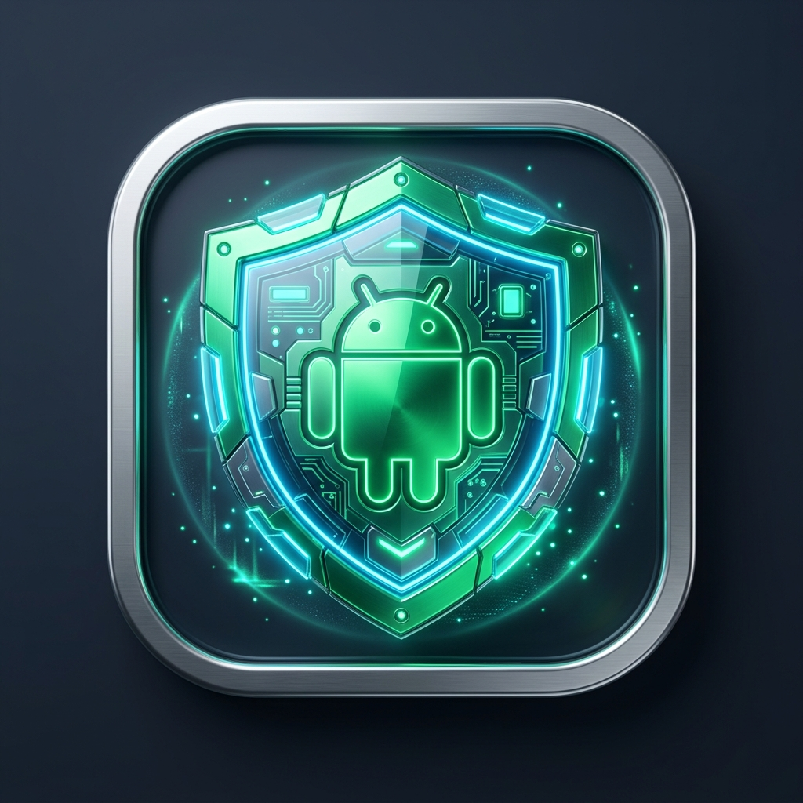

<p align="center">
  
</p>

<h1 align="center">Android Rescue Shield</h1>

<p align="center">
  <strong>Lightweight Desktop Rescue & Adware Removal Tool for Android via ADB</strong><br>
  โปรแกรมกู้ภัยมือถือโดนล็อกหน้าจอ • ถอนแอปขโมยหน้าจอ • ล้างบาง Adware เด้งรัว
</p>

<p align="center">
  
  
  
  
</p>

---

## 📌 The Problem (ปัญหาที่เกิดขึ้น)
เมื่อโทรศัพท์มือถือ Android ติดมัลแวร์หรือ Adware อาการทั่วไปที่ผู้ใช้พบคือ:
1. **หน้าจอถูกขโมย (Screen Overlay Hijack):** โฆษณาหรือหน้าต่างปลอมเด้งบังตลอดเวลา ทัชสกรีนอะไรบนจอมือถือไม่ได้เลย
2. **รันตัวเองทันทีตอนเปิดเครื่อง (`BOOT_COMPLETED`):** รีสตาร์ทเครื่องแล้วไม่หาย เพราะตัวแอปจะสตาร์ทตัวเองทันทีก่อนที่เราจะทันกดลบ
3. **พรางตัว & ล็อกสิทธิ์:** ซ่อนไอคอนในหน้าหลัก (No Launcher Activity) หรือแอบขอสิทธิ์ **Device Admin** ทำให้ปุ่ม "ถอนการติดตั้ง" ใน Settings กลายเป็นสีเทากดไม่ได้

**Android Rescue Shield** แก้ปัญหานี้ด้วยการสั่งการระดับฮาร์ดแวร์ผ่านสาย USB (ADB) จากคอมพิวเตอร์ ทำให้สั่งปลดล็อกและถอนการติดตั้งได้ 100% โดยไม่ต้องพึ่งพาหน้าจอมือถือ

---

## 🏛️ The 3 Core Modules (3 โมดูลหลักในโปรแกรม)

### 🚨 [โมดูล 1] กู้ภัยปราบแอปป่วนจอ (Rescue Shield)
- **Instant Emergency Kill:** ตรวจจับแบบ Real-time ว่าแอปใดกำลังแสดงผลทับหน้าจออยู่ กดปุ่มเดียวสั่ง Force-Stop ให้มือถือหลุดจากการล็อกทันที
- **👻 Ghost Touch Killer:** ปุ่มคลิกเดียวสั่ง **ปิดสิทธิ์ Accessibility ทั้งหมด** ปราบแอปที่กำลังเลื่อนจอเองหรือแย่งแตะหน้าจอให้เป็นอัมพาตทันที
- **❄️ App Freezing:** แช่แข็งแอป (`pm disable-user`) สำหรับแอปดื้อด้านที่ชอบรีสตาร์ทตัวเอง
- **🗑️ Force / Silent Uninstall:** สั่งถอนการติดตั้งผ่าน ADB พร้อมระบบ **ปลดสิทธิ์ Device Admin อัตโนมัติ** ก่อนลบ
- **🔍 Deep Risk Inspector:** สแกนตรวจจับสิทธิ์อันตราย (`SYSTEM_ALERT_WINDOW`, `BOOT_COMPLETED`, ซ่อนไอคอน)

### 🏦 [โมดูล 2] ปลดล็อกแอปธนาคาร & เป๋าตังค์ (Bank Safety Guard)
- **📷 Background Camera Inspector:** ตรวจจับว่ามีแอปใดกำลังแอบเปิดเซ็นเซอร์กล้องค้างอยู่เบื้องหลัง พร้อมปุ่มสั่งปิดทันที เพื่อให้สแกนใบหน้า KYC ผ่านฉลุย
- **👁️ Anti-Spyware & Remote Check:** ตรวจจับสิทธิ์การเข้าถึงพิเศษ (Accessibility) ที่เสี่ยงต่อการถูกรีโมทดูดเงิน
- **🔒 One-Click Disable USB Debugging:** ปุ่มคลิกเดียวจากคอมพิวเตอร์เพื่อ **สั่งปิดการดีบัก USB และโหมดนักพัฒนาในมือถือทันที** เพื่อให้เปิดเข้าแอปเป๋าตัง / ทางรัฐ / K PLUS / SCB ได้ทันทีโดยไม่ติดบล็อก

### 🧹 [โมดูล 3] ลบแอปขยะติดเครื่องจากโรงงาน (Universal Debloater)
- **Zero-Root Debloating:** ลบแอปขยะที่โรงงานยัดมา (Facebook Services, Mi Ads/Cleaner, Samsung Bixby, แอปค่ายมือถือ) ผ่าน `pm uninstall --user 0` โดยไม่ต้องรูทเครื่อง
- **Curated Safety Presets:** มีระบบแนะนำความปลอดภัย (🟢 ปลอดภัยลบได้ / 🟡 แนะนำหากไม่ใช้)
- **🔄 One-Click Restore:** สามารถกดปุ่ม **"กู้คืน"** แอปเดิมกลับมาได้ตลอดเวลา ไม่ต้องกลัวเครื่องมีปัญหา

---

## 💡 Technician Field Hacks (เคล็ดลับช่างแก้จอค้างก่อนต่อคอม)
1. **📴 สูตรตัดเน็ตทันที (ถอดซิม + ปิด WiFi):** จิ้มถาดซิมการ์ดออกทันที โฆษณาจะโหลดไม่ขึ้น จอจะหยุดเด้ง 80%
2. **🛡️ สูตรเข้า Safe Mode (โหมดปลอดภัย):** กดปุ่ม Power ค้าง > แตะปุ่ม "ปิดเครื่อง" ค้างไว้ 2 วินาที (หรือใช้ปุ่มลดเสียง) ระบบจะแช่แข็งแอปภายนอก 100% ทำให้เปิด USB Debugging ได้แบบไม่ต้องแข่งกับเวลา *(ออกจาก Safe Mode แค่รีสตาร์ทเครื่องปกติ 1 ครั้ง)*
3. **🖱️ สูตรเมาส์ OTG:** เสียบเมาส์คอมพิวเตอร์ผ่านสาย OTG เข้าตูดมือถือเพื่อคลิกรูดหน้าจอเข้า Settings กรณีทัชสกรีนหลอก

---

## 🚀 Quick Start (วิธีเริ่มต้นใช้งาน)

### 1. การเตรียมโทรศัพท์มือถือ (ทำครั้งเดียว)
1. เข้า **การตั้งค่า (Settings)** > **เกี่ยวกับโทรศัพท์ (About phone)** > แตะที่ **"หมายเลขบิลด์ (Build Number)"** 7 ครั้ง เพื่อเปิด *โหมดนักพัฒนา*
2. เข้า **ตัวเลือกสำหรับนักพัฒนา (Developer Options)** > เปิดใช้งาน **"การดีบัก USB" (USB Debugging)**
3. เสียบสาย USB เข้าคอมพิวเตอร์ หากมีป๊อปอัปขึ้นบนมือถือ ให้ติ๊ก **"อนุญาตเสมอจากคอมพิวเตอร์นี้" (Always allow)** แล้วกด ตกลง

### 2. เปิดใช้งานโปรแกรม
ดับเบิ้ลคลิกไฟล์ **`start.bat`** ในโฟลเดอร์โปรเจกต์:
```bash
# หรือรันผ่าน Terminal
node server.js
```
หน้าต่างโปรแกรม GUI จะเปิดขึ้นมาอัตโนมัติที่ `http://localhost:3210`

---

## 📄 License
This project is licensed under the MIT License - see the [LICENSE](LICENSE) file for details.
